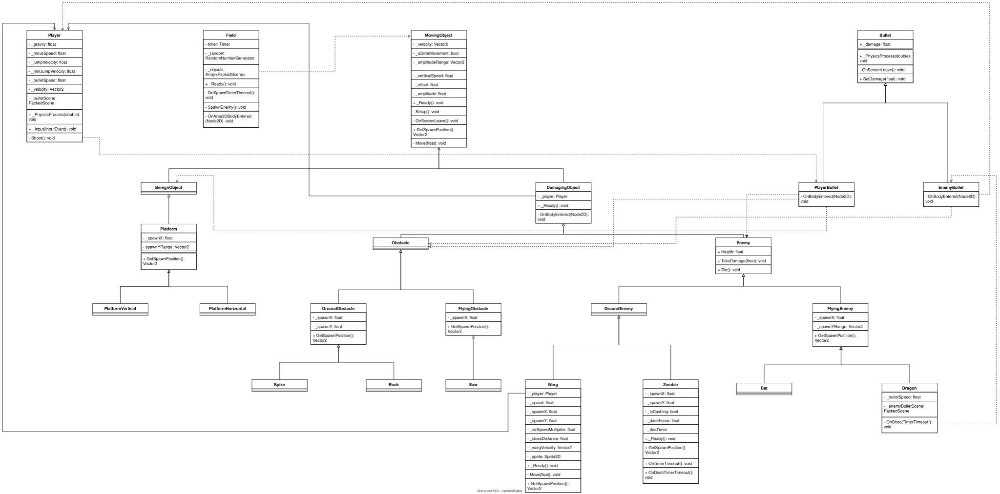

# Лабораторная работа №2. Прототип платформера

Проект представляет собой бесконечный раннер. Игрок может перепрыгивать препятствия и отстреливать врагов. При столкновении с ними игрок умирает и уровень начинается заново.
Взаимодействие объектов между собой реализовано через слои и маски коллизии.

## Управление

* **A** — двигаться влево.
* **D** — двигаться вправо.
* **Space** — прыжок. Чем дольше держать клавишу, тем выше прыгнет игрок.
* **ЛКМ** — выстрел.

## Структура сцен проекта

1. Field.tscn - главная сцена проекта. На ней спавнятся все враги и объекты, а также сам игрок. При выходе за границы поля игрок умирает, а любой объект удаляется.
2. Player - игрок. Спавнится на игровом поле. Может отстреливать врагов сталкиваться с объектами, прыгать и врезаться в платформы.
3. PlatformHorizontal/PlatformVertical - платформы. Спавнятся на поле случайным образом. Игрок может запрыгивать на них.
4. Bat/Dragon/Warg/Zombie - враги. При столкновении с ними игрок умирает. Врагов можно убить пулями.
5. Rock/Saw/Spike - объекты. Их нельзя убить, а при столкновении с ними игрок умирает.
6. PlayerBullet/EnemyBullet - пули игрока и врага.

	
## Иерархия классов проекта

### 1 Уровень

* **1.** **Класс MovingObject** — основной класс для всех движущихся объектов. Задаёт все основные методы для дочерних классов: удаление при выходе за пределы экрана, точку спавна, движение по прямой и по синусоиде (для определённых объектов это можно задать через панель Inspector. Таким образом можно избежать дублирования кода в дочерних классах).
* **2.** **Класс Bullet** — основной класс для всех типов пуль. Задаёт урон от пули, её удаление при выходе за пределы экрана, движение.
* **3.** **Класс Player** — игрок. Реализованы его основные действия: движение, стрельба, прыжки. Через этот класс также создаётся пуля для стрельбы.
* **4.** **Класс Field** — игровое поле. Через этот класс создаются все враги и препятствия. Отдельно в сцене игрового поля есть стены-границы. При столкновении с ними игра начинается сначала. Внутри класса реализована эта логика.

### 2 Уровень

* **1.1.** **Класс DamagingObject** — основной класс для всех объектов, которые наносят урон игроку. Отдельно задаёт перезапуск игры, если объект этого класса столкнулся с игроком (то есть все объекты класса «убивают» игрока).
* **1.2.** **Класс BenignObject** — основной класс для объектов, не наносящих вред игроку. Объекты этого класса безвредны для игрока. В коде класса BenignObject ничего нет, вся необходимая логика реализована выше/ниже по иерархии.
* **2.1.** **Класс PlayerBullet** — реализация пули игрока. Отдельная обработка сигналов коллизии (в частности, если объект является врагом — ему наносится урон).
* **2.2.** **Класс EnemyBullet** — реализация пули врага. Отдельная обработка сигналов коллизии (в частности, если объект — игрок, то игра начинается сначала).

В коде класса BenignObject ничего нет, вся необходимая логика реализована выше/ниже по иерархии.

### 3 Уровень

* **1.1.1.** **Класс Enemy** — основной класс для всех врагов. Отдельно реализована смерть врага, если здоровье <= 0, получение урона, и задана переменная здоровья (по умолч. 0, в дочерних классах задаётся отдельно).
* **1.1.2.** **Класс Obstacle** — объекты. На этом уровне в классе нет отдельной логики, всё необходимое прописано либо в дочерних, либо в родительских классах. В коде класса Obstacle ничего нет, вся необходимая логика реализована выше/ниже по иерархии.
* **1.2.1.** **Класс Platform** — платформы. В этом классе реализовано задание позиции спавна для всех платформ.

В коде класса Obstacle ничего нет, вся необходимая логика реализована выше/ниже по иерархии.

### 4 Уровень

* **1.1.1.1.** **Класс GroundEnemy** — основной класс для врагов, движущихся по земле. В классе отдельно задаётся здоровье всех наземных врагов - 30. Позиция спавна прописана в каждом дочернем классе отдельно, т.к. она отличается в зависимости от объекта. В коде класса ничего нет, вся логика реализована выше/ниже по иерархии.
* **1.1.1.2.** **Класс FlyingEnemy** — основной класс для всех летающих врагов. В классе отдельно задаётся здоровье всех летающих врагов -  10. Также отдельно реализовано определение точки спавна — для всех летающих врагов она одинакова.
* **1.1.2.1.** **Класс GroundObstacle** — основной класс для объектов на земле. В классе отдельно задаётся позиция спавна для всех объектов этого класса.
* **1.1.2.2.** **Класс FlyingObstacle** — основной класс для всех летающих объектов. В классе отдельно задаётся позиция спавна для всех объектов этого класса.
* **1.2.1.1.** **Класс PlatformHorizontal** — горизонтальная платформа. Игрок может запрыгивать на неё и ходить по ней. В коде класса ничего нет, вся логика реализована выше/ниже по иерархии.
* **1.2.1.2.** **Класс PlatformVertical** — вертикальная платформа. Игрок может запрыгнуть на неё, но не может ходить (в силу её длины). В коде класса ничего нет, вся логика реализована выше/ниже по иерархии.

В коде классов GroundEnemy, PlatformHorizontal, PlatformVertical ничего нет, вся их логика реализована выше/ниже по иерархии.

### 5 Уровень

* **1.1.1.1.1.** **Zombie** — враг, движущийся на игрока, делая рывки.
* **1.1.1.1.2.** **Warg** — враг, преследующий игрока (движется быстрее, чем Zombie). Варг быстро бежит на игрока, а если через него перепрыгнуть — он снова побежит на игрока из-за спины.
* **1.1.1.2.1.** **Bat** — враг, летящий на игрока по синусоиде. В коде класса ничего нет, вся логика реализована выше по иерархии.
* **1.1.1.2.2.** **Dragon** — враг, прямо летящий на игрока и делающий выстрелы.
* **1.1.2.1.1.** **Rock** — объект, движущийся на игрока. У объекта нет особой логики. В коде класса ничего нет, вся логика реализована выше по иерархии.
* **1.1.2.1.2.** **Spike** — объект, выдвигающийся из земли и обратно. В коде класса ничего нет, вся логика реализована выше по иерархии.
* **1.1.2.2.1.** **Saw** — объект, летящий по синусоиде. В коде класса ничего нет, вся логика реализована выше по иерархии.
	
В кодах классов Bat, Rock, Saw, Spike ничего нет, вся их логика реализована выше по иерархии.
При столкновении с любым из объектов 5-го уровня игрок умирает.

## Изменения в структуре

Увеличено количество врагов, каждый из которых реализует уникальную логику.
Общая для всех объектов логика вынесена в родительские классы. 
Пример: как враги, так и объекты могут летать по синусоиде, поэтому эта логика движения вынесена в самый верхний уровень.
Тогда внутри дочерних классов достаточно указать, что объект летит по данной траектории и дублирования кода не происходит.
Не на каждом уровне иерархии добавилась своя уникальная логика (это значит, что всё необходимое уже добавлено либо в дочерний, либо в родительский класс).

## UML-диаграмма проекта

